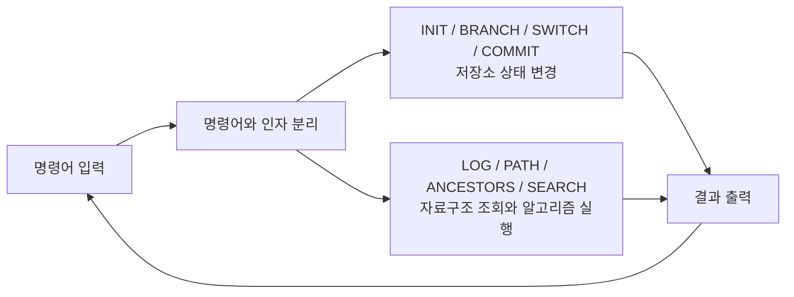
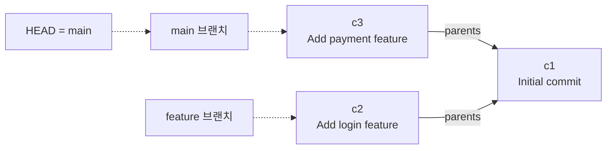
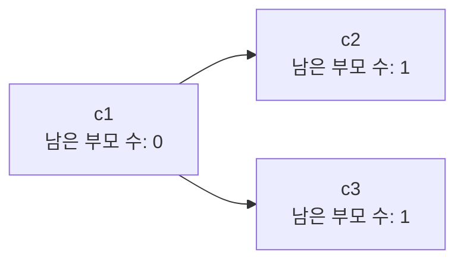
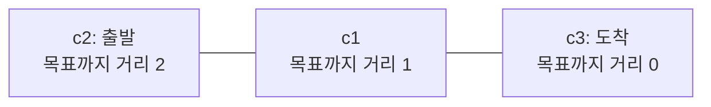
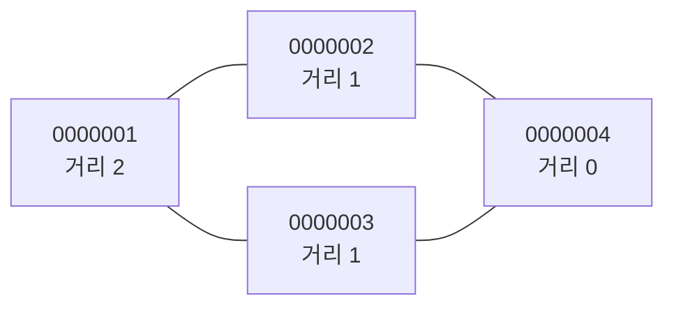
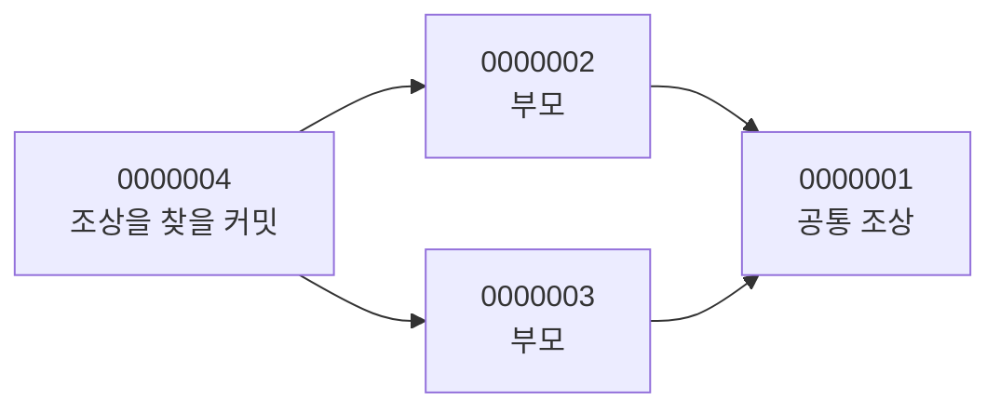
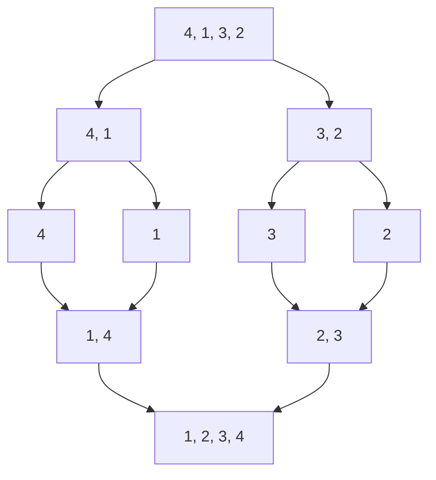
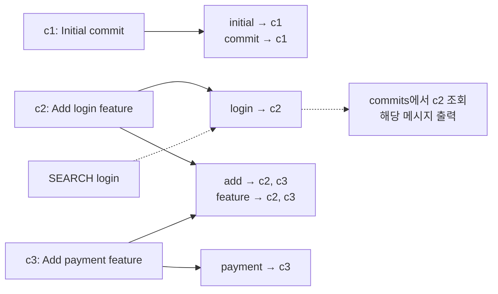

# Mini Git

Git의 핵심 구조(커밋 그래프, 브랜치, 로그, 검색)를 직접 구현한 CLI 프로그램입니다.
커밋 메타데이터만 다루며, 모든 데이터는 메모리에만 저장됩니다.

## 미션 한눈에 보기

이 미션은 명령어를 입력하면서 커밋 그래프를 만들고, 그 그래프를 탐색하는 프로그램입니다.
커밋은 노드, 부모 관계는 간선, 브랜치는 특정 커밋을 가리키는 참조입니다.



그림은 Mermaid 형식입니다. Mermaid를 지원하는 Markdown 미리보기에서 그림으로 볼 수 있습니다.
`exit` 또는 `quit`를 입력하면 반복을 끝냅니다.

## 실행

Python 3.10 이상, 외부 라이브러리 없음.

```bash
python main.py
```

`mini-git>` 프롬프트에 명령을 입력하고, `exit` 또는 `quit`로 종료합니다.

## 명령어

명령어는 대소문자를 구분하지 않습니다. 공백이 들어간 인자는 따옴표로 감쌉니다.

| 명령 | 설명 |
| --- | --- |
| `INIT <user_name>` | 저장소 초기화, `main` 브랜치 생성, 사용자 설정 |
| `BRANCH <branch_name>` | 현재 커밋을 가리키는 새 브랜치 생성 |
| `SWITCH <branch_name>` | HEAD를 해당 브랜치로 이동 |
| `COMMIT <message>` | 현재 HEAD를 부모로 하는 커밋 생성 |
| `LOG` | 부모가 자식보다 먼저 나오는 순서로 전체 커밋 출력 |
| `LOG --sort-by=date\|author` | 시간 / 작성자 기준 정렬 출력 |
| `PATH <commit1> <commit2>` | 두 커밋 사이의 최단 경로 (없으면 `No path`) |
| `ANCESTORS <commit_hash>` | 해당 커밋의 모든 조상 출력 |
| `SEARCH <keyword>` | 메시지에 키워드가 포함된 커밋 검색 |
| `SEARCH --author=<name>` | 작성자의 커밋 검색 |

에러 메시지

| 메시지 | 나오는 경우 |
| --- | --- |
| `Invalid args` | 인자 개수나 옵션 형식이 틀림, 따옴표를 닫지 않음 |
| `Unknown command: <name>` | 없는 명령어 |
| `Unknown branch: <name>` | 없는 브랜치로 `SWITCH` |
| `Unknown commit: <hash>` | 없는 hash로 `PATH` / `ANCESTORS` |
| `Branch already exists: <name>` | 이미 있는 이름으로 `BRANCH` |
| `Not initialized. Run: INIT <user_name>` | `INIT` 전에 다른 명령 입력 |

결과가 없을 때의 출력

| 출력 | 나오는 경우 |
| --- | --- |
| `No commits` | 커밋이 하나도 없을 때 `LOG` |
| `No ancestors` | 부모가 없는 커밋에 `ANCESTORS` |
| `No path` | 두 커밋이 연결되어 있지 않을 때 `PATH` |
| `Found 0 commit(s):` | 일치하는 커밋이 없을 때 `SEARCH` |

## 실행 예시

새로 실행한 프로그램의 예시입니다. 이미 커밋을 만들었거나 `INIT`을 다시 했다면
hash가 달라질 수 있으므로, PATH에는 실제 출력된 hash를 입력합니다.

```
mini-git> init "Alice"
Initialized repository.
Current branch: main
Current user: Alice

mini-git> commit "Initial commit"
[main ffefc7d] Initial commit

mini-git> branch feature
Created branch: feature

mini-git> switch feature
Switched to branch: feature

mini-git> commit "Add login feature"
[feature 2edb318] Add login feature

mini-git> switch main
Switched to branch: main

mini-git> commit "Add payment feature"
[main 3ef0563] Add payment feature

mini-git> log
commit ffefc7d (Alice, 2026-11-13 12:02:33) [main]
    Initial commit
commit 2edb318 (Alice, 2026-11-13 12:02:40) [feature]
    Add login feature
commit 3ef0563 (Alice, 2026-11-13 12:02:51) [main]
    Add payment feature

mini-git> path 2edb318 3ef0563
Path: 2edb318 -> ffefc7d -> 3ef0563

mini-git> search login
Found 1 commit(s):
- 2edb318: Add login feature
```

## 코드 구조

| 파일 | 내용 |
| --- | --- |
| `main.py` | 실행 파일. REPL (입력 → 실행 → 출력 반복) |
| `cli.py` | `MiniGit`: 명령어 파싱, 명령별 처리 함수(`cmd_*`), 출력 형식 |
| `repository.py` | `Commit`: 커밋 노드 / `Repository`: 커밋 저장소와 브랜치 관리 |
| `algorithms.py` | `merge_sort`, `topological_sort`, `shortest_path`, `find_ancestors` |
| `inverted_index.py` | `InvertedIndex`: 역색인 |

의존 방향은 `main → cli → repository → inverted_index`이고, `cli`가 `algorithms`도
호출합니다. `algorithms.py`는 표준 라이브러리의 `collections.deque`를 사용합니다.

## 그림으로 이해하는 자료구조

### 1. 커밋은 노드, 부모 관계는 간선

앞의 실행 예시를 그림으로 옮기면 다음과 같습니다. 읽기 쉽도록 커밋 hash를
`c1`, `c2`, `c3`으로 줄여 부릅니다. 실제 명령에는 프로그램이 출력한 hash를 사용합니다.



**실선은 커밋 → 부모 방향**, 점선은 HEAD와 브랜치의 참조를 뜻합니다.
`c2`와 `c3`은 같은 부모 `c1`에서 갈라졌습니다. 서로의 부모는 아닙니다.

커밋 하나에는 아래 정보를 저장합니다.

| 필드 | 예: c2 | 의미 |
| --- | --- | --- |
| `hash` | `c2`로 표시한 실제 hash | 커밋 식별자 |
| `message` | `Add login feature` | 커밋 메시지 |
| `author` | `Alice` | 작성자 |
| `timestamp` | 커밋 생성 시각 | 날짜 정렬 기준 |
| `parents` | `[c1]` | 부모 커밋의 hash 목록 |
| `branch` | `feature` | 커밋을 만들 당시의 브랜치 이름 |

새 커밋은 이미 존재하는 커밋만 부모로 삼습니다. 명령어로 만든 부모 관계를
그대로 따라가면 과거로만 이동하므로 출발점으로 돌아오는 사이클이 생기지 않습니다.
이처럼 방향이 있고 사이클이 없는 그래프를 **DAG**라고 합니다.

### 2. HEAD와 브랜치는 무엇을 가리키나?

`HEAD`에는 현재 브랜치 이름을 저장하고, 각 브랜치는 마지막 커밋의 hash를 저장합니다.
다음 표는 위 그림이 만들어지는 과정입니다.

| 실행한 명령 | HEAD | main이 가리키는 커밋 | feature가 가리키는 커밋 |
| --- | --- | --- | --- |
| `INIT Alice` | `main` | `None` | 없음 |
| `COMMIT "Initial commit"` | `main` | c1 | 없음 |
| `BRANCH feature` | `main` | c1 | c1 |
| `SWITCH feature` | `feature` | c1 | c1 |
| `COMMIT "Add login feature"` | `feature` | c1 | c2 |
| `SWITCH main` | `main` | c1 | c2 |
| `COMMIT "Add payment feature"` | `main` | c3 | c2 |

`BRANCH`는 같은 커밋을 가리키는 참조를 하나 추가합니다. `SWITCH`는 HEAD의 브랜치 이름을
바꿉니다. `COMMIT`은 현재 브랜치의 커밋을 부모로 삼고, 그 브랜치만 새 커밋으로 옮깁니다.
로그의 `[feature]` 같은 표시는 커밋 생성 당시의 브랜치 이름입니다.
현재 브랜치가 가리키는 위치는 `branches` 딕셔너리로 관리합니다.

### 3. 딕셔너리와 인접 목록으로 그래프 저장하기

같은 그래프를 실제 자료형으로 나타내면 다음과 같습니다. 아래 hash 이름은 설명용입니다.

```text
commits                       branches
  c1 -> Commit(parents=[])       main    -> c3
  c2 -> Commit(parents=[c1])     feature -> c2
  c3 -> Commit(parents=[c1])
                              head = "main"
children
  c1 -> [c2, c3]
  c2 -> []
  c3 -> []
```

`commits[hash]`로 커밋을 평균 O(1)에 찾습니다. `parents`는 부모 방향으로 이동할 때,
`children`은 자식 방향으로 이동할 때 사용합니다. 이렇게 노드마다 연결된 이웃을
목록으로 저장하는 방식을 **인접 목록**이라고 합니다.

Mini Git의 hash는 `카운터:작성자:메시지`를 SHA-1으로 바꾼 뒤 앞 7자리를 사용합니다.
이미 사용한 값이면 카운터를 증가시켜 다시 만듭니다. 카운터와 사용한 hash 집합은
저장소 밖에 있어, `INIT`으로 커밋과 브랜치를 지워도 프로그램 종료 전까지 유지됩니다.

## 그림으로 이해하는 알고리즘

### 1. LOG: 부모부터 출력하는 위상 정렬

기본 `LOG`는 전체 저장소에서 부모 커밋이 자식보다 먼저 나오도록 출력합니다.
이를 위해 Kahn 알고리즘을 사용합니다. 여기서는 `children`을 이용해
**부모 → 자식 방향으로** 처리합니다. 이 방향에서 부모 수가 진입 차수가 됩니다.



큐는 먼저 넣은 것을 먼저 꺼내는 자료구조입니다. 남은 부모 수가 0인 커밋만 큐에 넣습니다.

| 단계 | 큐: 왼쪽부터 꺼냄 | 출력한 커밋 | 처리 내용 |
| --- | --- | --- | --- |
| 시작 | `[c1]` | `[]` | 부모가 없는 c1을 큐에 넣음 |
| c1 처리 후 | `[c2, c3]` | `[c1]` | c2와 c3의 남은 부모 수가 1 → 0이 되어 큐에 넣음 |
| c2 처리 후 | `[c3]` | `[c1, c2]` | c2에는 자식이 없음 |
| c3 처리 후 | `[]` | `[c1, c2, c3]` | 큐가 비어 종료 |

부모가 여러 개라면 모든 부모를 처리한 뒤에야 큐에 들어갑니다.
따라서 자식이 부모보다 먼저 출력되지 않습니다. 시간복잡도는 **O(V + E)** 입니다.
`V`는 커밋 수, `E`는 부모 연결 수입니다.

### 2. PATH: BFS로 간선 수가 가장 적은 경로 찾기

`PATH c2 c3`은 부모·자식 연결을 **양방향으로 이동할 수 있는 간선**으로 봅니다.
따라서 형제 커밋 사이에서도 부모를 거쳐 이동할 수 있습니다.



**BFS**(너비 우선 탐색)는 큐를 이용해 가까운 노드부터 차례로 방문합니다.
모든 간선의 비용이 1이므로, 처음 방문했을 때의 거리가 최소 간선 수입니다.
코드에서는 도착점인 c3에서 BFS를 시작합니다.

| BFS 단계 | 새로 방문한 커밋 | c3까지 거리 |
| --- | --- | --- |
| 시작 | c3 | 0 |
| 한 간선 이동 | c1 | 1 |
| 두 간선 이동 | c2 | 2 |

그다음 출발점 c2에서 거리가 1씩 줄어드는 이웃을 선택합니다.
결과는 `c2 → c1 → c3`입니다. BFS에서 출발점에 도달하지 못했다면 `No path`를 출력합니다.

#### 최단 경로가 여러 개라면?

아래는 **다중 부모 그래프를 알고리즘 함수에 넣었다고 가정한 예시**입니다.
현재 CLI에는 머지 명령이 없으므로 이 모양을 명령어만으로 만들 수는 없습니다.
숫자는 설명용 hash이며, 선은 PATH에서 양방향으로 이동할 수 있는 연결입니다.



`0000004.parents = [0000002, 0000003]`이고, `0000002`와 `0000003`의 부모는
`0000001`입니다. `0000001`에서 `0000004`로 가는 최단 경로는 두 개입니다.

```text
0000001 -> 0000002 -> 0000004  선택
0000001 -> 0000003 -> 0000004
```

거리가 1 줄어드는 이웃 중 사전순으로 가장 작은 hash를 고릅니다.
두 경로 모두 길이는 2이고, 처음 달라지는 hash에서 `0000002 < 0000003`이므로
첫 번째 경로를 선택합니다. 현재 hash는 모두 같은 길이의 7자리 문자열입니다.
시간복잡도는 거리 계산과 경로 복원을 합쳐 **O(V + E)** 입니다.

### 3. ANCESTORS: 부모 방향으로만 BFS

`ANCESTORS`는 `parents`만 따라가며 모든 조상을 찾습니다.
앞의 다중 부모 예시에 부모 방향 화살표를 그리면 다음과 같습니다.



| 처리한 커밋 | 새로 찾은 조상 | 방문 집합의 역할 |
| --- | --- | --- |
| `0000004` | `0000002`, `0000003` | 두 부모를 방문 처리하고 큐에 넣음 |
| `0000002` | `0000001` | 공통 조상을 처음 발견해 큐에 넣음 |
| `0000003` | 없음 | `0000001`은 이미 방문했으므로 건너뜀 |
| `0000001` | 없음 | 부모가 없어 종료 |

방문 집합(`set`) 덕분에 같은 조상을 여러 번 출력하지 않습니다.
출발 커밋 자체는 조상 목록에 넣지 않습니다. 시간복잡도는 도달한 부분 그래프에 대해
O(V + E)이며, 전체 그래프 기준으로도 **O(V + E)** 이내입니다.

### 4. LOG --sort-by: 병합 정렬

`LOG --sort-by=date`는 timestamp, `LOG --sort-by=author`는 작성자 이름의 오름차순으로
정렬합니다. 기본 `LOG`의 부모 우선 출력과 달리, 옵션을 주면 지정한 키의 순서로 나열합니다.

아래 숫자는 정렬 키를 단순화한 예시입니다. 목록을 절반씩 나눈 뒤,
정렬된 작은 목록을 차례로 합쳐 전체를 정렬합니다.



마지막 병합에서 비교하는 과정은 다음과 같습니다.

| 남은 왼쪽 목록 | 남은 오른쪽 목록 | 이번에 선택 | 누적 결과 |
| --- | --- | --- | --- |
| `[1, 4]` | `[2, 3]` | 1 | `[1]` |
| `[4]` | `[2, 3]` | 2 | `[1, 2]` |
| `[4]` | `[3]` | 3 | `[1, 2, 3]` |
| `[4]` | `[]` | 남은 4 | `[1, 2, 3, 4]` |

비교 값이 같으면 왼쪽 원소를 먼저 선택합니다(`<=`). 그래서 같은 timestamp나
작성자 이름을 가진 커밋은 원래의 생성 순서를 유지합니다. 이를 **안정 정렬**이라고 합니다.
`key` 함수를 바꿔 하나의 병합 정렬 구현으로 날짜와 작성자 정렬을 모두 처리합니다.

| 항목 | 값 | 이유 |
| --- | --- | --- |
| 평균 시간복잡도 | O(n log n) | 약 log n개의 분할 단계마다 총 n개를 병합 |
| 최악 시간복잡도 | O(n log n) | 입력 순서와 관계없이 같은 방식으로 분할·병합 |
| 추가 공간 | O(n) | 나눈 목록과 병합 결과를 저장 |
| 안정 정렬 | 예 | 값이 같으면 왼쪽 원소를 먼저 선택 |

`n`은 정렬할 커밋 수입니다. `sorted()`와 `list.sort()`는 사용하지 않습니다.

### 5. SEARCH: 역색인으로 후보 바로 찾기

역색인은 **검색어 → 그 검색어를 가진 커밋 hash 목록**을 미리 저장한 자료구조입니다.
커밋 생성 시 메시지를 공백으로 나누고 소문자로 바꿔 등록합니다.
같은 메시지에 같은 단어가 여러 번 나와도 그 커밋은 한 번만 등록합니다.



검색 시 인덱스에서 후보 hash를 가져온 뒤, 그 hash로 `commits`를 조회합니다.
전체 커밋의 메시지를 매번 읽어 볼 필요가 없습니다.

```text
키워드 역색인                       작성자 역색인
  login   -> [c2]                     Alice -> [c1, c2, c3]
  payment -> [c3]
  feature -> [c2, c3]
```

`SEARCH --author=Alice`도 같은 방식으로 작성자 인덱스에서 후보를 가져옵니다.
여러 단어를 입력하면 모든 단어가 포함된 커밋을 찾도록 후보들의 교집합을 구합니다.

```text
SEARCH "login feature"

login   -> [c2]
feature -> [c2, c3]
교집합  -> [c2]
```

단일 키워드의 딕셔너리 조회는 평균 O(1)이고, 결과 k개의 hash 목록을 복사하는 데
O(k)가 걸립니다. 검색어를 정규화하는 비용과 결과를 출력하는 비용도 필요합니다.
전체 순회 검색은 결과가 적어도 모든 커밋의 메시지를 확인해야 합니다.
여러 단어를 검색하면 각 후보 목록을 읽고 교집합을 구하는 비용이 추가됩니다.
질의 길이를 q, 각 후보 목록 길이를 pᵢ라고 하면 결과 출력 전까지 평균 O(q + Σpᵢ)입니다.
검색을 빠르게 하는 대신, 커밋 시 인덱스 갱신 비용과 이를 저장할 메모리가 필요합니다.

검색은 완전한 토큰 단위입니다. `log`로 `login`을 찾을 수 없으며, 구두점을 제거하지
않으므로 `login!`도 `login`과 다른 키워드입니다. 메시지 키워드는 대소문자를
구분하지 않고, 작성자 이름은 대소문자를 구분합니다.

## 다른 사람에게 설명하는 순서

1. "커밋은 노드, 부모 관계는 간선"이라고 소개하고 브랜치가 갈라진 그래프를 보여 줍니다.
2. HEAD와 브랜치의 참조를 짚으며 BRANCH / SWITCH / COMMIT으로 무엇이 바뀌는지 설명합니다.
3. LOG는 부모부터 출력하고, ANCESTORS는 부모로만, PATH는 양방향으로 이동한다고 설명합니다.
4. 정렬은 병합 정렬의 분할·병합 그림으로, 검색은 역색인의 후보 조회 그림으로 설명합니다.

## 범위

- 머지 명령이 없어 실제로는 커밋마다 부모가 0개 또는 1개입니다. `parents`는
  리스트이고 탐색 함수들은 부모가 여러 개여도 동작합니다.
- 첫 커밋 전에 만든 브랜치에서 각각 커밋하면 부모 없는 커밋(루트)이 따로 생길 수 있습니다.
  서로 다른 루트에 속한 커밋 사이에는 경로가 없어 `PATH`가 `No path`를 출력합니다.
- `INIT`을 다시 실행하면 저장소(커밋, 브랜치, 역색인)가 초기화됩니다.
