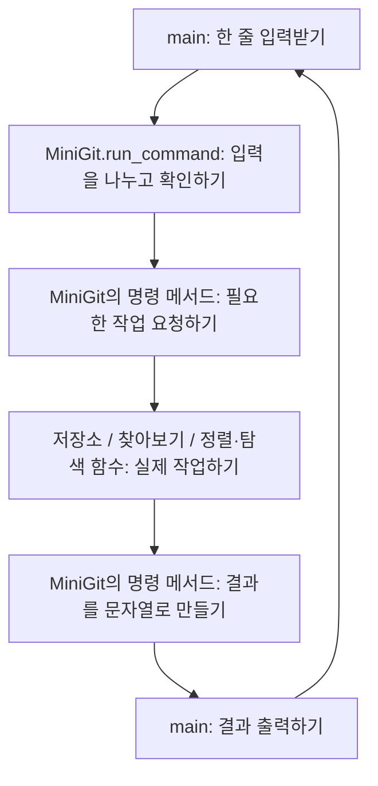

# 함수와 클래스 안내서

이 문서는 [main.py](../main.py)의 클래스와 함수가 각각 어떤 일을 하는지 설명해요.
코드의 1장부터 7장까지 순서대로 따라가며 읽으면 돼요.
현재 프로그램처럼 `MiniGit` 하나로 명령어를 계속 받는 사용 방식을 기준으로 설명해요.

## 먼저 알아둘 말

| 말 | 뜻 | 이 코드의 예 |
| --- | --- | --- |
| 클래스 | 관련된 데이터와 기능을 한곳에 묶는 설계도예요. | `Repository` |
| 객체 | 설계도로 실제로 만든 것이에요. | `Repository(...)`로 만든 저장소 |
| 함수 | 입력을 받아 정해진 일을 하는 코드 묶음이에요. | `split_into_words(text)` |
| 메서드 | 클래스 안에 들어 있는 함수예요. | `repo.make_commit(message)` |
| 인자 | 함수를 부를 때 전달하는 값이에요. | `message`에 전달한 `"Add login"` |
| 반환값 | 함수가 일을 마치고 돌려주는 값이에요. | 새 커밋 객체, 번호 목록, 결과 문자열 |
| `None` | 돌려줄 값이 없거나, 결과가 없음을 나타내는 값이에요. | 경로를 찾지 못했을 때 |

`self`는 **지금 이 메서드를 실행하는 객체 자신**을 뜻해요.
예를 들어 `self.commits`는 “이 저장소가 가지고 있는 커밋들”이에요.
아래 메서드 이름에서는 Python이 자동으로 전달하는 `self`를 생략했어요.

`__init__()`은 객체를 만들 때 자동으로 실행되는 준비 함수예요.
`MiniGit()`을 만들면 `MiniGit.__init__()`이 실행돼요.
사용자가 입력하는 `INIT` 명령은 별도로 `MiniGit.init(args)`가 처리해요.

## 전체 흐름



잘못된 입력은 중간 검사에서 에러 메시지로 돌아올 수 있어요.
`exit`와 `quit`는 `main()`이 받아서 반복을 끝내요.

### 클래스 여섯 개의 역할

| 클래스 | 맡은 일 | 만들어지는 곳 |
| --- | --- | --- |
| `MiniGitError` | 사용자에게 알려줄 에러를 나타내요. | 인자·브랜치·커밋 등을 검사하는 곳 |
| `Commit` | 커밋 하나의 정보를 담아요. | `Repository.make_commit()` |
| `HashMaker` | 중복되지 않는 커밋 번호를 발급해요. | `MiniGit.__init__()` |
| `SearchBook` | 단어·작성자로 커밋을 찾는 표를 관리해요. | `Repository.__init__()` |
| `Repository` | 커밋·브랜치·현재 위치를 관리해요. | `MiniGit.init()` |
| `MiniGit` | 입력한 명령을 알아듣고 작업을 연결해요. | `main()` |

## 공통: 사용자에게 알려줄 에러

### MiniGitError

없는 브랜치로 이동하거나 인자를 잘못 입력했을 때 사용하는 에러 클래스예요.
Python의 `Exception`을 이어받고, 직접 정의한 메서드는 없어요.

```python
raise MiniGitError("Unknown branch: feature")
```

이 에러가 발생하면 `MiniGit.run_command()`가 잡아서 메시지를 문자열로 돌려줘요.
마지막에 `main()`이 그 문자열을 화면에 출력해요.

## 1장. 커밋과 번호 만들기

### Commit

커밋 한 개를 표현하는 클래스예요. 기록 카드 한 장이라고 생각하면 돼요.

#### Commit.__init__(commit_hash, message, author, timestamp, parents, branch)

- **하는 일:** 전달받은 정보를 객체의 필드에 저장해요.
- **입력:** 아래 표의 여섯 가지 정보예요.
- **반환값:** 준비 함수 자체는 `None`을 반환해요. `Commit(...)`이라는 생성 표현식으로 새 객체를 얻어요.
- **호출하는 곳:** `Repository.make_commit()`이에요.

| 저장하는 필드 | 담는 내용 |
| --- | --- |
| `hash` | 커밋 번호인 문자열 |
| `message` | 무엇을 했는지 적은 메모 |
| `author` | 작성자 이름 |
| `timestamp` | 커밋 생성 시각 |
| `parents` | 부모 커밋 번호들의 리스트. 첫 커밋은 `[]`예요. |
| `branch` | 커밋을 만들 당시의 브랜치 이름 |

번호나 시각을 직접 만드는 클래스는 아니에요. `Repository.make_commit()`이 준비한 값을 받아 보관해요.
`branch` 필드는 생성 당시의 이름이고, 현재 브랜치 위치는 저장소의 `branches`가 관리해요.

### HashMaker

커밋 번호를 발급하는 클래스예요. 번호를 어디까지 만들었는지, 어떤 번호를 썼는지 기억해요.

#### HashMaker.__init__()

- **하는 일:** 번호를 발급할 준비를 해요.
- **저장하는 값:** `count = 0`, `used = set()`이에요. `used`에는 사용한 번호를 모아요.
- **입력 / 반환값:** 별도 입력이 없고, 반환값은 `None`이에요.
- **호출하는 곳:** `MiniGit.__init__()`이 `HashMaker()`를 만들 때 실행돼요.

#### HashMaker.make(author, message)

- **하는 일:** 카운터를 하나 올리고 `카운터:작성자:메모`를 SHA-1으로 바꿔요. 앞 7글자를 번호 후보로 써요.
- **입력:** 작성자 이름과 커밋 메시지예요.
- **반환값:** 아직 사용하지 않은 7자리 hash 문자열이에요.
- **호출하는 곳:** `Repository.make_commit()`이에요.

후보가 `used`에 있으면 다시 만들어요. 새 번호를 찾으면 `used`에 등록하고 돌려줘요.
`MiniGit`이 같은 번호 발급기를 계속 보관하므로, `INIT`을 다시 해도 사용한 번호를 기억해요.

## 2장. 단어와 작성자로 찾기

### split_into_words(text)

- **하는 일:** 글을 소문자로 바꾸고 공백으로 나눈 다음, 중복 단어를 제거해요. 처음 나온 순서는 유지해요.
- **입력:** 커밋 메시지나 검색어 문자열이에요.
- **반환값:** 단어 문자열들의 리스트예요. 공백뿐이면 `[]`를 돌려줘요.
- **호출하는 곳:** `SearchBook.add()`, `SearchBook.find_by_words()`예요.

```text
입력: "Add Login login"
결과: ["add", "login"]
```

구두점은 제거하지 않아요. 따라서 `login`과 `login!`은 서로 다른 단어예요.

### SearchBook

검색용 찾아보기 표를 관리하는 클래스예요. 이런 표를 **역색인**이라고 해요.

```text
words:   "login" -> [그 단어가 들어간 커밋 번호들]
authors: "Alice" -> [Alice가 만든 커밋 번호들]
```

#### SearchBook.__init__()

- **하는 일:** 단어 표 `words`와 작성자 표 `authors`를 빈 딕셔너리로 만들어요.
- **입력 / 반환값:** 별도 입력이 없고, 반환값은 `None`이에요.
- **호출하는 곳:** `Repository.__init__()`이 `SearchBook()`을 만들 때 실행돼요.

#### SearchBook.add(commit)

- **하는 일:** 메시지의 각 단어와 작성자 이름을 찾아보기 표에 등록해요.
- **입력:** 커밋 객체 한 개예요.
- **반환값:** `None`이에요. 결과를 반환하는 대신 `words`와 `authors`를 바꿔요.
- **호출하는 곳:** 새 커밋을 만든 `Repository.make_commit()`이에요.

한 메시지에 `login`이 여러 번 나와도, 이번 등록에서는 `login`의 목록에 해당 커밋 번호를 한 번만 넣어요.

#### SearchBook.find_by_words(text)

- **하는 일:** 입력한 단어가 모두 들어 있는 커밋을 찾아요.
- **입력:** 검색어 문자열이에요. 예를 들어 `"login feature"`예요.
- **반환값:** 일치하는 커밋의 **hash 문자열 리스트**예요. 결과가 없으면 `[]`예요.
- **호출하는 곳:** 키워드 검색을 처리하는 `MiniGit.search()`예요.

첫 단어의 후보 목록에서 시작해 다음 단어가 없는 후보를 빼요. 모든 메시지를 다시 읽지 않고 표를 조회해요.

```text
login   -> [B]
feature -> [B, C]
두 단어 모두 있는 커밋 -> [B]
```

메시지와 검색어를 모두 소문자로 바꾸므로 키워드의 대소문자는 구분하지 않아요.

#### SearchBook.find_by_author(author)

- **하는 일:** 작성자 표에서 그 사람이 만든 커밋을 찾아요.
- **입력:** 작성자 이름 문자열이에요.
- **반환값:** 커밋의 hash 문자열 리스트예요. 결과가 없으면 `[]`예요.
- **호출하는 곳:** `SEARCH --author=...`를 처리하는 `MiniGit.search()`예요.

이름은 대소문자를 구분해요. `Alice`와 `alice`는 다르게 취급해요.

## 3장. 저장소 관리하기

### Repository

커밋 그래프와 브랜치 상태를 보관하고 바꾸는 클래스예요.

#### Repository.__init__(author, hash_maker)

- **하는 일:** 새 저장소를 준비하고, 커밋이 없는 `main` 브랜치를 만들어요.
- **입력:** 현재 작성자와 계속 사용할 번호 발급기예요.
- **반환값:** `None`이에요.
- **호출하는 곳:** `INIT`을 처리하는 `MiniGit.init()`이에요.

| 필드 | 맡은 일 |
| --- | --- |
| `author` | 새 커밋에 기록할 작성자 이름 |
| `commits` | `hash -> Commit` 딕셔너리 |
| `children` | `hash -> 자식 hash 목록` 딕셔너리 |
| `branches` | `브랜치 이름 -> 마지막 커밋 hash` 딕셔너리 |
| `current_branch` | 현재 선택한 브랜치 이름. 이 코드의 HEAD예요. |
| `search_book` | 이 저장소의 단어·작성자 찾아보기 표 |
| `hash_maker` | `MiniGit`에서 전달받은 번호 발급기 |

처음에는 `branches = {"main": None}`, `current_branch = "main"`이에요.

#### Repository.make_branch(name)

- **하는 일:** 현재 브랜치와 같은 커밋을 가리키는 새 브랜치를 만들어요. 커밋을 복사하지 않아요.
- **입력:** 새 브랜치 이름이에요.
- **반환값:** `None`이에요. `branches`에 새 항목이 생겨요.
- **호출하는 곳:** `MiniGit.branch()`예요.

이미 있는 이름이면 `Branch already exists: <name>` 에러를 발생시켜요.
아직 커밋이 없다면 새 브랜치도 `None`을 가리켜요.

#### Repository.switch_branch(name)

- **하는 일:** `current_branch`를 지정한 이름으로 바꿔요.
- **입력:** 이동할 브랜치 이름이에요.
- **반환값:** `None`이에요.
- **호출하는 곳:** `MiniGit.switch()`예요.

없는 이름이면 `Unknown branch: <name>` 에러를 발생시켜요.
이동만으로 새 커밋을 만들거나 기존 커밋을 옮기지는 않아요.

#### Repository.make_commit(message)

- **하는 일:** 현재 브랜치에 새 커밋을 만들고 저장소의 관련 정보를 함께 갱신해요.
- **입력:** 커밋 메시지 문자열이에요.
- **반환값:** 새로 만든 **Commit 객체**예요.
- **호출하는 곳:** `MiniGit.commit()`이에요.

작업 순서는 다음과 같아요.

1. 현재 브랜치가 가리키는 커밋을 부모로 정해요. 없으면 부모 목록은 `[]`예요.
2. `HashMaker.make()`로 번호를 받고, 현재 시각과 함께 `Commit`을 만들어요.
3. `commits`에 새 커밋을 저장하고 `children`에 새 커밋의 자식 목록을 준비해요.
4. 부모가 있다면 부모의 자식 목록에 새 커밋 번호를 추가해요.
5. 현재 브랜치가 새 커밋을 가리키게 해요.
6. `SearchBook.add()`로 검색 표를 갱신해요.

#### Repository.get_commit(commit_hash)

- **하는 일:** 번호에 해당하는 커밋을 꺼내요.
- **입력:** 커밋 hash 문자열이에요.
- **반환값:** 저장되어 있는 **Commit 객체**예요.
- **호출하는 곳:** `MiniGit.path()`, `MiniGit.ancestors()`예요.

없는 번호이면 `Unknown commit: <hash>` 에러를 발생시켜요.
이 검사를 통과한 뒤에 탐색을 시작하므로, 잘못된 커밋 번호를 사용자에게 알려줄 수 있어요.

## 4장. 날짜나 작성자로 정렬하기

### sort_value(commit, sort_by)

- **하는 일:** 커밋에서 비교할 값 하나를 꺼내요.
- **입력:** 커밋 객체와 정렬 기준 문자열이에요.
- **반환값:** `sort_by == "date"`이면 `timestamp`, 그 외에는 `author`예요.
- **호출하는 곳:** 두 목록을 병합하는 `merge()`예요.

허용하는 옵션인지 검사하는 일은 `MiniGit.log()`가 맡아요.
이 함수는 전달받은 기준에 따라 실제 비교 값을 고르는 역할이에요.

### merge_sort(commits, sort_by)

- **하는 일:** 목록을 절반씩 나누고, 정렬된 작은 목록들을 병합해서 전체를 정렬해요.
- **입력:** Commit 객체들의 리스트와 `"date"` 또는 `"author"`예요.
- **반환값:** 정렬된 **새 Commit 리스트**예요. 커밋 객체 자체를 새로 복제하지는 않아요.
- **호출하는 곳:** 정렬 옵션을 받은 `MiniGit.log()`와 자기 자신이에요.

0개 또는 1개라면 이미 정렬된 것이므로 바로 리스트를 돌려줘요.
그보다 많으면 왼쪽과 오른쪽을 각각 정렬한 뒤 `merge()`로 합쳐요.
이처럼 함수가 자기 자신을 다시 부르는 것을 **재귀 호출**이라고 해요.

### merge(left, right, sort_by)

- **하는 일:** 이미 정렬된 두 목록을 하나의 정렬된 목록으로 합쳐요.
- **입력:** 왼쪽·오른쪽 Commit 리스트와 정렬 기준이에요.
- **반환값:** 두 목록의 커밋을 합친 새 리스트예요.
- **호출하는 곳:** `merge_sort()`예요.

각 목록의 앞쪽 값부터 `sort_value()`로 비교하고 작은 쪽을 먼저 넣어요.
값이 같으면 왼쪽을 먼저 넣어 기존 순서를 지켜요. 이것이 **안정 정렬**의 이유예요.
한쪽이 끝나면 다른 쪽의 남은 커밋을 그대로 뒤에 붙여요.

## 5장. 그래프를 탐색하기

이 장의 예시에서 A·B·C는 읽기 쉽게 줄인 커밋 번호예요.
실제 명령에는 화면에 나온 7자리 hash를 넣어요.

```text
B: 로그인 ──부모──▶ A: 시작 ◀──부모── C: 결제
```

### parent_first_order(repo)

- **하는 일:** 부모가 자식보다 먼저 나오는 위상 정렬 순서를 구해요.
- **입력:** 저장소 객체예요.
- **반환값:** 출력할 순서대로 담긴 **hash 문자열 리스트**예요. 저장소가 비었으면 `[]`예요.
- **호출하는 곳:** 옵션 없는 `LOG`를 처리하는 `MiniGit.log()`예요.

`waiting`에는 각 커밋의 **아직 처리하지 않은 부모 수**를 기록해요.
그 수가 0인 커밋만 `line`에 넣고 앞에서부터 처리해요.
부모 하나를 처리할 때마다 자식의 `waiting`을 1 줄이고, 0이 되면 큐에 넣어요.

예시에서는 A를 먼저 처리한 다음 B와 C를 처리해요.
이 함수는 출력할 번호만 정하고, 화면에 직접 출력하지는 않아요.

### neighbors(repo, commit_hash)

- **하는 일:** 어떤 커밋의 부모와 자식 번호를 하나의 목록으로 모아요.
- **입력:** 저장소와 커밋 hash예요.
- **반환값:** `parents + children`으로 만든 새 hash 리스트예요.
- **호출하는 곳:** `count_steps_from()`, `find_shortest_path()`예요.

길 찾기에서는 부모·자식 연결을 양방향으로 이동하므로 두 목록이 모두 필요해요.

### count_steps_from(repo, start)

- **하는 일:** 시작 커밋에서 각 커밋까지의 최소 이동 횟수를 BFS로 구해요.
- **입력:** 저장소와 시작 커밋 hash예요.
- **반환값:** `hash -> 이동 횟수` 딕셔너리예요. 시작점의 값은 0이에요.
- **호출하는 곳:** `find_shortest_path()`예요.

한 칸 거리부터 차례로 방문하고, 이미 거리표에 적은 커밋은 다시 넣지 않아요.
연결되어 있지 않은 커밋은 결과 딕셔너리에 들어가지 않아요.

### find_shortest_path(repo, start, goal)

- **하는 일:** 두 커밋 사이에서 간선 수가 가장 적은 경로를 찾아요.
- **입력:** 저장소, 출발 hash, 도착 hash예요.
- **반환값:** 출발점과 도착점이 포함된 hash 리스트예요. 경로가 없으면 `None`이에요.
- **호출하는 곳:** `MiniGit.path()`예요.

1. `count_steps_from(repo, goal)`을 호출해 **도착점부터** 거리를 재요.
2. 출발점이 거리표에 없으면 `None`을 반환해요.
3. 출발점에서 거리가 1씩 줄어드는 이웃으로 이동해요.
4. 후보가 여러 개면 사전순으로 가장 작은 hash를 골라요.

예시에서 B부터 C까지는 `[B, A, C]`예요. 출발점과 도착점이 같으면 `[start]`예요.

### find_ancestors(repo, start)

- **하는 일:** 부모 방향으로만 BFS를 해서 모든 조상을 찾아요.
- **입력:** 저장소와 조상을 알아볼 커밋 hash예요.
- **반환값:** 조상의 hash 리스트예요. 조상이 없으면 `[]`예요.
- **호출하는 곳:** `MiniGit.ancestors()`예요.

`found` 집합에 이미 찾은 조상을 기록해 중복 방문을 막아요.
출발 커밋 자체는 조상 결과에 넣지 않아요.
예시에서 C의 조상은 A이고, 다른 갈래인 B는 포함되지 않아요.

### 탐색에서 line과 position을 함께 쓰는 이유

`line`에는 처리할 커밋 번호를 차례로 추가하고, `position`은 다음에 처리할 위치를 가리켜요.
앞의 항목을 지우지 않고 위치만 하나씩 옮겨서 큐처럼 사용해요.
BFS는 가까운 거리부터, 위상 정렬은 부모 처리 조건을 만족한 커밋부터 진행해요.

## 6장. 명령어를 알아듣고 결과 만들기

### need_args(args, count)

- **하는 일:** 명령에 필요한 인자 개수가 맞는지 검사해요.
- **입력:** 인자 리스트와 필요한 개수예요.
- **반환값:** 개수가 맞으면 `None`이에요. 틀리면 `MiniGitError("Invalid args")`를 발생시켜요.
- **호출하는 곳:** `MiniGit`의 각 명령 메서드예요. `log()`는 옵션이 있을 때 사용해요.

예를 들어 `COMMIT "Add login"`의 인자는 `["Add login"]`이므로 개수가 1이에요.

### commit_to_text(commit)

- **하는 일:** 커밋 한 개를 로그에 보여줄 문자열로 바꿔요.
- **입력:** Commit 객체 한 개예요.
- **반환값:** hash·작성자·시각·브랜치·메시지가 들어 있는 문자열이에요.
- **호출하는 곳:** `commits_to_text()`예요.

```text
commit 2edb318 (Alice, 2026-11-15 09:10:00) [feature]
    Add login feature
```

### commits_to_text(commits, text_if_empty)

- **하는 일:** 커밋 여러 개를 각각 문자열로 만든 뒤 줄바꿈으로 이어 붙여요.
- **입력:** Commit 객체들의 리스트와, 비었을 때 대신 쓸 문자열이에요.
- **반환값:** 완성된 문자열이에요. 목록이 비었다면 `text_if_empty`를 반환해요.
- **호출하는 곳:** `MiniGit.log()`, `MiniGit.ancestors()`예요.

`commit_to_text()`와 이 함수는 글자를 만들기만 해요. 실제 `print()`는 `main()`이 해요.

### MiniGit

한 줄의 명령을 받아 저장소와 알고리즘에 필요한 작업을 요청하는 클래스예요.
이 클래스의 명령 메서드들은 마지막에 **화면에 보여줄 문자열**을 반환해요.

#### MiniGit.__init__()

- **하는 일:** `repo = None`으로 시작하고 `HashMaker` 하나를 만들어요.
- **입력 / 반환값:** 별도 입력이 없고, 반환값은 `None`이에요.
- **호출하는 곳:** `main()`이 `MiniGit()`을 만들 때예요.

아직 `INIT`을 하지 않았으므로 저장소는 없어요. 번호 발급기는 여기서 준비해 두고 계속 사용해요.

#### MiniGit.run_command(line)

- **하는 일:** 한 줄을 파싱하고, 검사하고, 알맞은 명령 메서드를 불러요.
- **입력:** 사용자가 입력한 문자열 한 줄이에요.
- **반환값:** 작업 결과 또는 에러 메시지 문자열이에요. 빈 입력이면 `""`예요.
- **호출하는 곳:** `main()`이에요.

처리 순서는 다음과 같아요.

1. `shlex.split()`으로 따옴표를 고려해 입력을 나눠요.
2. 첫 단어는 소문자로 바꿔 명령 이름으로, 나머지는 `args`로 정해요.
3. `ALL_COMMANDS`에 있는 명령인지 확인해요. 이것은 지원하는 여덟 명령을 담은 튜플이에요.
4. `INIT`이 필요한 명령이라면 저장소가 있는지 확인해요.
5. `init()`, `branch()`, `switch()`, `commit()`, `log()`, `path()`, `ancestors()`, `search()` 중 하나를 불러요.
6. 작업 중 발생한 `MiniGitError`는 잡아서 에러 메시지로 돌려줘요.

닫지 않은 따옴표는 `shlex.split()`의 `ValueError`를 따로 잡아 `Invalid args`로 알려줘요.
`exit`와 `quit`는 여기까지 전달되기 전에 `main()`이 처리해요.

```text
입력 한 줄: commit "Add login feature"
분리한 값:  ["commit", "Add login feature"]
명령 이름:  "commit"
args:       ["Add login feature"]
실행:       MiniGit.commit(args)
```

#### MiniGit.init(args)

- **입력:** `[사용자 이름]`이에요.
- **하는 일:** 인자 1개를 확인하고 `Repository(사용자 이름, 기존 번호 발급기)`를 새로 만들어요.
- **반환값:** 초기화 결과, 현재 브랜치, 현재 사용자가 들어 있는 문자열이에요.
- **실행 명령:** `INIT Alice`예요.

다시 실행하면 커밋·브랜치·찾아보기 표는 새로 시작하지만 `hash_maker`는 유지해요.

#### MiniGit.branch(args)

- **입력:** `[새 브랜치 이름]`이에요.
- **하는 일:** 인자 1개를 확인하고 `Repository.make_branch()`를 불러요.
- **반환값:** `Created branch: <name>` 문자열이에요.
- **실행 명령:** `BRANCH feature`예요.

#### MiniGit.switch(args)

- **입력:** `[이동할 브랜치 이름]`이에요.
- **하는 일:** 인자 1개를 확인하고 `Repository.switch_branch()`를 불러요.
- **반환값:** `Switched to branch: <name>` 문자열이에요.
- **실행 명령:** `SWITCH feature`예요.

#### MiniGit.commit(args)

- **입력:** `[커밋 메시지]`예요. 따옴표로 묶인 메시지는 공백이 있어도 인자 하나예요.
- **하는 일:** 인자 1개를 확인하고 `Repository.make_commit()`으로 새 커밋을 받아요.
- **반환값:** `[브랜치 hash] 메시지` 형태의 문자열이에요.
- **실행 명령:** `COMMIT "Add login feature"`예요.

실제로 커밋을 저장하는 일은 `Repository.make_commit()`이 맡고, 이 메서드는 요청과 결과 문구를 맡아요.

#### MiniGit.log(args)

- **입력:** 기본 로그라면 `[]`, 정렬 로그라면 `["--sort-by=date"]` 또는 `["--sort-by=author"]`예요.
- **하는 일:** 옵션이 없으면 `parent_first_order()`의 번호 순서로 커밋을 모아요. 옵션이 있으면 기준을 검사하고 `merge_sort()`를 불러요.
- **반환값:** `commits_to_text()`로 만든 로그 문자열이에요. 커밋이 없으면 `No commits`예요.
- **실행 명령:** `LOG`, `LOG --sort-by=date`, `LOG --sort-by=author`예요.

기본 로그는 부모 우선이고, 정렬 옵션이 있으면 선택한 값의 오름차순이에요.
지원하지 않는 옵션은 `Invalid args` 에러를 발생시켜요.

#### MiniGit.path(args)

- **입력:** `[출발 hash, 도착 hash]`예요.
- **하는 일:** 인자 2개를 확인하고 `Repository.get_commit()`으로 두 커밋이 있는지 검사한 뒤 `find_shortest_path()`를 불러요.
- **반환값:** `Path: hash1 -> hash2 -> ...` 문자열이에요. 연결되지 않았으면 `No path`예요.
- **실행 명령:** `PATH <출발 hash> <도착 hash>`예요.

없는 커밋을 입력한 경우에는 경로 없음과 달리 `Unknown commit: <hash>` 에러가 발생해요.

#### MiniGit.ancestors(args)

- **입력:** `[조상을 알아볼 hash]`예요.
- **하는 일:** 인자 1개와 커밋 존재 여부를 확인하고 `find_ancestors()`를 불러요. 반환된 번호들로 Commit 객체들을 모아요.
- **반환값:** `commits_to_text()`로 만든 조상 로그 문자열이에요. 조상이 없으면 `No ancestors`예요.
- **실행 명령:** `ANCESTORS <hash>`예요.

#### MiniGit.search(args)

- **입력:** `[검색어]` 또는 `["--author=작성자"]`예요.
- **하는 일:** 인자 1개를 확인하고, `--author=`로 시작하면 `find_by_author()`, 아니면 `find_by_words()`를 불러요.
- **반환값:** 검색 개수와 각 커밋의 번호·메시지를 담은 문자열이에요. 결과가 없어도 `Found 0 commit(s):`를 돌려줘요.
- **실행 명령:** `SEARCH login`, `SEARCH "login feature"`, `SEARCH --author=Alice`예요.

`SEARCH --author=`처럼 작성자 값이 비어 있으면 `Invalid args` 에러를 발생시켜요.

## 7장. 프로그램 시작하기

### main()

- **하는 일:** `mini-git>`에서 입력받고, 명령을 실행하고, 결과를 출력하는 일을 반복해요. 이것이 REPL이에요.
- **입력:** 함수 인자는 없어요. 실행 중 `input()`으로 사용자 입력을 받아요.
- **반환값:** 종료할 때 `None`이에요.
- **호출되는 때:** 이 파일을 직접 실행했을 때예요.

1. `MiniGit` 객체 하나를 만들어요.
2. `while True` 안에서 한 줄을 받아요.
3. 더 읽을 입력이 없는 `EOFError`이거나, 입력이 `exit` / `quit`이면 반복을 끝내요.
4. 나머지 입력은 `run_command()`로 보내요.
5. 반환된 문자열이 비어 있지 않으면 `print()`로 보여 줘요.

파일 끝의 코드는 “직접 실행했을 때만 `main()`을 시작해라”라는 뜻이에요.
다른 파일에서 이 파일을 불러오기만 하면 REPL이 자동으로 시작되지 않아요.

```python
if __name__ == "__main__":
    main()
```

## 한 명령이 연결되는 실제 예시

`INIT Alice`를 한 상태에서 `COMMIT "Add login feature"`를 입력했다고 생각해 봐요.

```text
main()
  └─ MiniGit.run_command(입력 한 줄)
       └─ MiniGit.commit(["Add login feature"])
            ├─ need_args(args, 1)
            └─ Repository.make_commit("Add login feature")
                 ├─ HashMaker.make(author, message): 번호 발급
                 ├─ datetime.now(): 시각 확인
                 ├─ Commit(...): 커밋 객체 생성
                 ├─ commits / children / branches 갱신
                 └─ SearchBook.add(commit): 찾아보기 표 갱신
                      └─ split_into_words(message): 단어 정리

Repository.make_commit → Commit 객체를 돌려줘요.
MiniGit.commit        → 그 객체로 결과 문자열을 만들어요.
MiniGit.run_command   → 결과 문자열을 main으로 전달해요.
main                  → 화면에 출력해요.
```

## 헷갈리기 쉬운 구분

| 구분 | 차이 |
| --- | --- |
| `MiniGit.__init__()` / `MiniGit.init(args)` | 전자는 MiniGit 객체의 첫 준비, 후자는 사용자의 `INIT` 명령 처리예요. |
| `Repository.make_commit()` / `MiniGit.commit()` | 전자는 저장소를 바꾸고 Commit을 반환해요. 후자는 명령을 처리하고 문자열을 반환해요. |
| hash 리스트 / Commit 리스트 | `["2edb318"]`은 번호 목록이고, `[커밋 객체]`는 기록 전체를 담은 객체 목록이에요. |
| 문자열 반환 / 화면 출력 | 함수가 글자를 돌려주는 것과 `main()`이 `print()`하는 것은 다른 일이에요. |
| `None` / `[]` / `""` | 각각 값 없음, 빈 목록, 빈 문자열이에요. 함수의 반환값 설명을 보고 구별해요. |

### 표준 라이브러리 세 가지

| 가져온 도구 | 사용하는 이유 |
| --- | --- |
| `hashlib` | `HashMaker.make()`에서 SHA-1을 계산해요. |
| `shlex` | `run_command()`에서 따옴표를 고려해 입력을 나눠요. |
| `datetime` | 커밋 생성 시각을 기록하고, 날짜 정렬과 로그 표시에 사용해요. |

실행하려면 프로젝트 폴더에서 `python main.py`를 사용해요.
